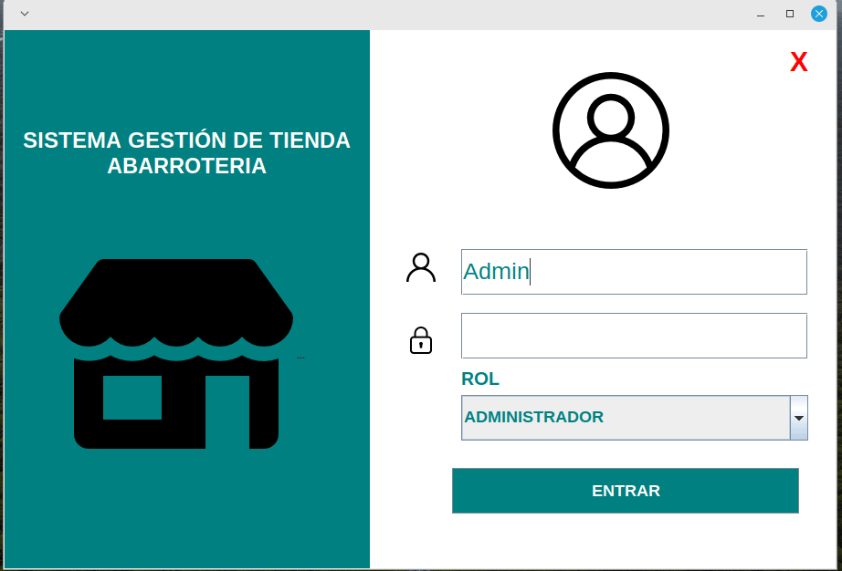
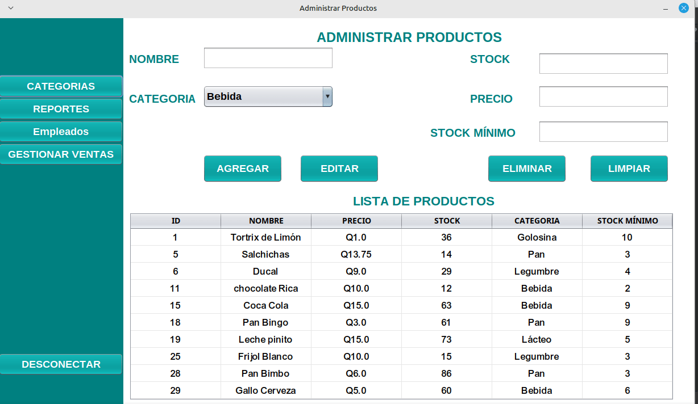
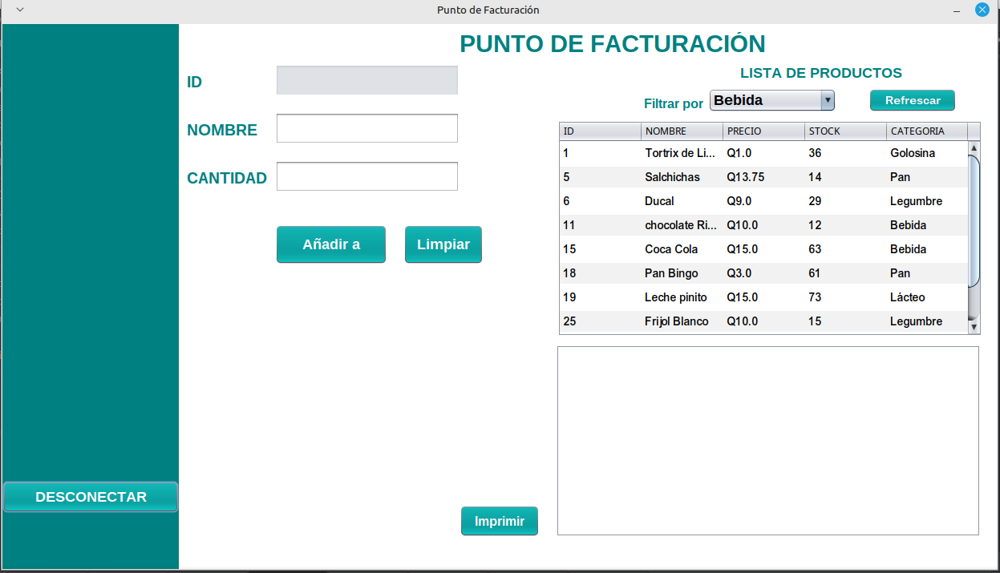

# Sistema de Gestión para Abarrotería

Este proyecto es una aplicación de escritorio diseñado para automatizar el control de inventario, ventas y proveedores de una aborrotería pequeña o mediana. Utiliza **java** Swing para la interfaz gráfica y **Maven** para la gestión de dependencias.

## 📋 Características

- **Gestión de Inventario:** Control total sobre el stock, precios de compra y venta.

- **Punto de Venta (Pos):** Interfaz rápida para realizar ventas y generar recibos.

- **Reportes**: Visualización de ventas diarias, total vendido y productos con poco stock.  

- **Seguridad**: Sistema de login para administradores y empleados.

- **Validaciones**: Control de entrada para evitar errores en precios o cantidades.  

## 🛠️ Requisitos del Sistema

Para ejecutar o contribuir en este proyecto, necesitas:

- **JDK 17**: El proyecto utiliza características de Java 17.

- **Apache Maven 3.8+**: Para construcción y gestión de librerías.

- **IDE Recomendado:** IntelliJ IDEA, NetBeans o Eclipse con soporte para Maven.

## 🗄️ Configuración de la Base de Datos

Antes de iniciar la aplicación, es obligatorio configurar la base de datos. El sistema utiliza **MariaDB** (Compatible con MySQL) y espera una base de datos llamada `tienda_abarroteria`.

1. **Crear la Base de Datos**
   
    Accede a tu terminal de MariaDB o herramienta de gestión (como workbench, DBeaver o HeidiSQL ) y ejecuta: 
   
   ```bash
   CREATE DATABASE tienda_aborroteria;
   USE tienda_aborroteria;
   ```

2. **Ejecutar el Script SQL**
   
   Importa el archivo de esquema ubicado en la carpeta del proyecto (recomendado) o crea las tablas necesarias. Ubicación del script:
   
   `src/main/resources/database/schema.sql`

3. **Configurar Credenciales en Java**
   
   Busca la clase de conexión llamada `ConexionBD.java` (en carpeta config) y asegúrate de que los parámetros coincidan con tu entorno: 
   
   ```java
   // Ejemplo de configuración en el código
   private  final String BASEDATOS = "tienda_aborroteria";
   private  final String URL = "jdbc:mysql://localhost:3306/" + BASEDATOS + "?useSSL=false&serverTimezone=UTC";
   private  final String USUARIO = "tu_usuario";
   private  final String PASSWORD = "tu_password";
   ```

4. **Iniciar sesión al sistema:**
   
   - Usuario: Admin
   
   - Clave: admin

## 🔧Instalación y Ejecución

#### 1. Clonar el repositorio

```bash
git clone https://github.com/Melkisetek/sistema-tienda-abarroteria.git
cd sistema-tienda-abarroteria
```

#### 2. Construir el proyecto con Maven

Este comando descargará las dependencias necesarias y compilará el código:

```bash
mvn clean install
```

#### 3. Puede iniciar el sistema directamente desde la terminal:

```bash
mvn exec:java -Dexec.mainClass="tienda.tiendaabarroteria.App"
```

## 📂 Estructura del Proyecto (Maven)

## 📦 Dependencias Principales

El archivo `pom.xml` incluye las siguientes librerías:

- **JDBC Driver:** Para la conexión con la base de datos.

- **jar-plugin:** Plugin para genera un JAR ejecutable

## 🖼️ Vistas del Sistema

*Figura 1: Login administradores/empleados*


*Figura 1: Pantalla principal de inicio modo Admin, módulo de gestión de productos*


*Figura 2: Módulo de punto de venta*


## ✒️ Autores

- **Melquisedec** - *Desarrollador* - [Melquisedec](https://github.com/Melkisetek)